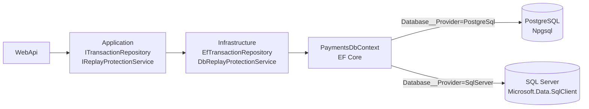
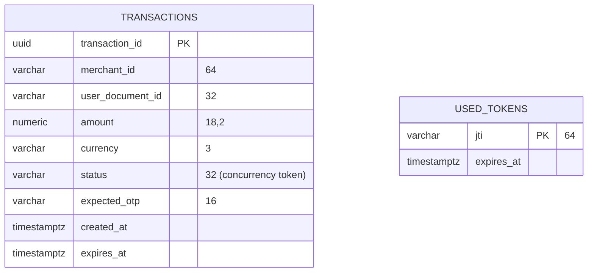

# 7. Capa de datos (ORM) – PostgreSQL o SQL Server

## 7.1 Visión general
La persistencia local en memoria fue **retirada**. Ahora todo el estado vive en una base de datos relacional a través de **Entity Framework Core 10**, y el motor se elige por configuración, sin recompilar.


Las capas Domain y Application **no conocen** el ORM ni el motor: solo ven las interfaces. El proveedor se decide en un único punto (`DependencyInjection.AddInfrastructure`).

## 7.2 Qué cambió respecto a la versión anterior
| Antes (en memoria) | Ahora |
|---|---|
| `InMemoryTransactionRepository` | `EfTransactionRepository` + tabla `payments.transactions` |
| `InMemoryReplayProtectionService` | `DbReplayProtectionService` + tabla `payments.used_tokens` (PK única = atómico) |
| Se perdía todo al reiniciar | Los datos persisten; el reinicio no invalida transacciones |
| 1 sola réplica posible | Varias réplicas (con la misma clave RSA, sección 7.8) |
| – | Control de concurrencia optimista sobre el estado de la transacción |
| – | Purga periódica de tokens vencidos (`ExpiredTokenCleanupService`) |
| – | `/healthz/ready` verifica la conexión a la BD |

## 7.3 Configuración
Dos valores deciden todo:

| Clave | Variable de entorno | Valores |
|---|---|---|
| `Database:Provider` | `Database__Provider` | `PostgreSql` · `SqlServer` |
| `ConnectionStrings:Default` | `ConnectionStrings__Default` | Cadena del motor elegido |

**PostgreSQL (Npgsql)**
```
Host=db.miempresa.com;Port=5432;Database=decoupledpayments;Username=dp_app;Password=***;SSL Mode=Require
```
**SQL Server**
```
Server=sql.miempresa.com,1433;Database=decoupledpayments;User Id=dp_app;Password=***;Encrypt=True
```
(Solo en desarrollo con certificado autofirmado: añadir `TrustServerCertificate=True`.)

Otros parámetros opcionales:
| Clave | Por defecto | Descripción |
|---|---|---|
| `Database:Initialization` | `EnsureCreated` | `EnsureCreated` crea la base/tablas al arrancar; `None` no toca el esquema |
| `Database:MaxRetries` | `10` | Intentos de conexión al inicializar |
| `Database:RetryDelaySeconds` | `3` | Espera entre intentos |

Además, EF Core aplica reintentos ante fallos transitorios de conexión (`EnableRetryOnFailure`) en ambos motores.

> La cadena de conexión es un **secreto**: pásela por variable de entorno, Docker/Kubernetes secret, `oc secret` o un gestor como Vault. No la guarde en `appsettings.json` ni en el repositorio.

## 7.4 Modelo de datos
Esquema `payments` (mismos nombres en ambos motores):


| Tabla | Propósito | Índices |
|---|---|---|
| `payments.transactions` | Una fila por transacción de pago | PK `transaction_id`; `ix_transactions_status_expires (status, expires_at)` |
| `payments.used_tokens` | `jti` de cada `transaction_token` consumido (anti-replay) | PK `jti`; `ix_used_tokens_expires_at` |

Tipos por motor: `uuid`/`uniqueidentifier`, `numeric(18,2)`/`decimal(18,2)`, `timestamptz`/`datetime2` (fechas siempre en UTC; el ORM fuerza `Kind=Utc` al leer).

El estado se guarda como texto: `PendingOtpVerification`, `Authorized`, `Executed`, `Failed`.

## 7.5 Creación del esquema
Tres opciones:

1. **`EnsureCreated` (por defecto, APOC/pruebas).** Al arrancar crea la base (si el usuario tiene permiso) y las tablas. Es simple pero **no evoluciona** el esquema: si cambia el modelo no migra una base ya creada.
2. **Scripts SQL (recomendado en entornos controlados).** Use `Database__Initialization=None` y aplique el script del motor:
   - PostgreSQL: `database/postgresql/001_create_schema.sql`
   - SQL Server: `database/sqlserver/001_create_schema.sql`
3. **Migraciones de EF Core (evolución continua).** No se incluyen en la APOC porque requieren un conjunto de migraciones **por proveedor**. Si las adopta, instale `dotnet-ef` y `Microsoft.EntityFrameworkCore.Design`, genere un directorio de migraciones por motor y cambie `Initialization` a `None`.

Permisos mínimos del usuario de la aplicación: con scripts, `SELECT/INSERT/UPDATE/DELETE` sobre el esquema `payments`; con `EnsureCreated`, además crear base/esquema/tablas.

## 7.6 Cambiar de motor
1. Provisione la base destino y, si usa scripts, ejecute el script de ese motor.
2. Cambie `Database__Provider` y `ConnectionStrings__Default`.
3. Reinicie el backend. La **misma imagen** sirve para ambos motores.

> **No hay migración automática de datos entre motores.** Las transacciones son efímeras (vigencia de 5 minutos) y los `jti` vencen en 60 s, por lo que normalmente basta con cambiar en una ventana sin tráfico. Si necesita conservar el histórico, expórtelo con las herramientas del motor antes del cambio.

## 7.7 Concurrencia y consistencia
- **Anti-replay atómico:** `DbReplayProtectionService` inserta el `jti` en una PK única. Si dos peticiones con el mismo token llegan a la vez, solo una inserta; la otra recibe violación de unicidad, el servicio confirma que la fila existe y responde `409 TOKEN_ALREADY_USED`. La detección no depende del código de error del motor, así que funciona igual en PostgreSQL y SQL Server.
- **Concurrencia optimista:** la columna `status` es *concurrency token*. Un `UPDATE` solo aplica si el estado sigue siendo el leído; si otra operación lo cambió, EF lanza `DbUpdateConcurrencyException` y la API responde `409 CONCURRENT_UPDATE`. Evita, por ejemplo, ejecutar dos veces el mismo débito.
- **Purga:** cada 5 minutos se eliminan los `jti` vencidos (un token vencido ya no supera la validación del JWT, por lo que borrar su `jti` es seguro).

## 7.8 Varias réplicas del backend
Con el estado en la BD, solo falta que **todas las réplicas firmen y validen con la misma clave RSA**:
```bash
openssl genpkey -algorithm RSA -pkeyopt rsa_keygen_bits:2048 -out jwt-private.pem
export JWT_PRIVATE_KEY_PEM="$(cat jwt-private.pem)"     # Docker Compose
# OpenShift/Kubernetes: secret dp-jwt-key con la clave Jwt__PrivateKeyPem (ver doc 06)
```
Sin `Jwt__PrivateKeyPem` cada instancia genera una clave efímera, y el log lo advierte. Para producción, mantenga la clave en un KMS/HSM/Vault.

Cree también el esquema **antes** de escalar (scripts, o primer arranque con una sola réplica) para evitar que varias réplicas ejecuten `EnsureCreated` a la vez.

## 7.9 Seguridad de la capa de datos
- Use un usuario de aplicación con **mínimos privilegios**, distinto del administrador (`sa`/`postgres`).
- Cifre la conexión (`SSL Mode=Require` / `Encrypt=True`) y limite el acceso de red a la BD.
- `expected_otp` se guarda en claro porque en la APOC el OTP es **simulado** (`123456`). En producción el OTP debe generarse/validarse con un canal externo (TOTP, push, SMS) y **no persistirse**, o persistirse solo como hash con caducidad corta.
- No se almacenan el `session_token`, el `callback_url` ni el `source_account_id` (ver manual técnico, sección 15).
- Programe respaldos del motor y pruebe la restauración.

## 7.10 Verificación y consultas útiles
```sql
-- Estado actual de las transacciones
SELECT status, COUNT(*) FROM payments.transactions GROUP BY status;

-- Últimas transacciones
SELECT transaction_id, merchant_id, amount, currency, status, created_at
FROM payments.transactions ORDER BY created_at DESC;

-- Tokens consumidos aún no purgados
SELECT COUNT(*) FROM payments.used_tokens;
```
(La sintaxis `LIMIT` de PostgreSQL equivale a `TOP` en SQL Server si necesita acotar resultados.)

Comprobación de conectividad desde la API: `GET /healthz/ready` → `200 {"status":"ready"}`; `503` si no hay conexión.

## 7.11 Resumen de archivos
| Archivo | Rol |
|---|---|
| `Infrastructure/Persistence/PaymentsDbContext.cs` | Contexto EF Core |
| `Infrastructure/Persistence/Configurations/*.cs` | Mapeo de tablas/columnas, índices, concurrencia |
| `Infrastructure/Persistence/EfTransactionRepository.cs` | Implementa `ITransactionRepository` |
| `Infrastructure/Services/DbReplayProtectionService.cs` | Implementa `IReplayProtectionService` |
| `Infrastructure/Persistence/DatabaseInitializer.cs` | `EnsureCreated` con reintentos |
| `Infrastructure/DependencyInjection.cs` | Selección del proveedor por configuración |
| `database/*/001_create_schema.sql` | Esquema para entornos controlados |
