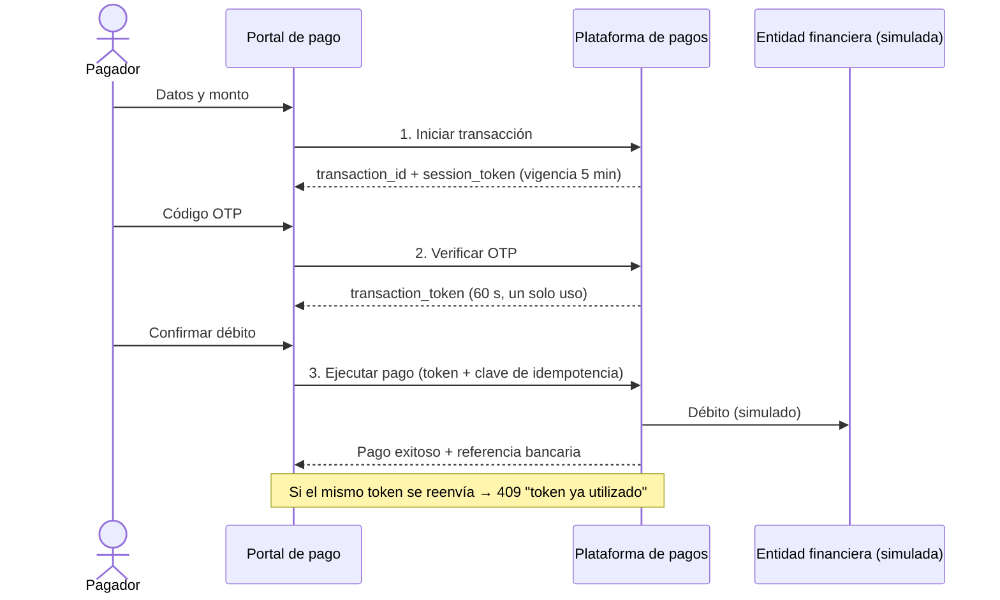
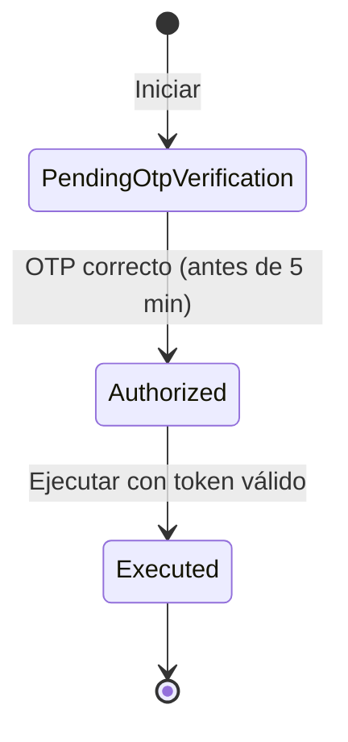

# Manual Funcional – APOC Pago Desacoplado

| | |
|---|---|
| **Producto** | APOC de pago desacoplado con OTP y token de un solo uso |
| **Versión** | 1.1 (con persistencia en base de datos) |
| **Audiencia** | Analistas de negocio, QA, líderes de producto, operaciones |
| **Documento fuente** | *Especificacion_Arquitectura_Pago_Desacoplado_NET10.docx* |

---

## 1. Introducción
### 1.1 Objetivo
Demostrar (prueba de concepto) un flujo de pago **desacoplado**, en el que la autorización del usuario y la ejecución del débito son pasos separados y se unen mediante un **token de un solo uso y vida muy corta**.

### 1.2 Alcance
Incluye: iniciación del pago, validación del OTP, emisión del token de autorización, ejecución del débito y bloqueo de reutilización del token (anti-replay).
No incluye (simulado en la APOC): conexión real con el banco, envío real del OTP, notificación al comercio (callback), conciliación y reportes. Ver sección 12.

### 1.3 ¿Qué problema resuelve?
En un pago tradicional, quien inicia la operación y quien la autoriza comparten el mismo canal. Si un tercero captura la petición de débito, podría repetirla. El esquema desacoplado reduce ese riesgo: el débito solo se acepta con un token emitido **después** de validar al usuario, válido **60 segundos** y utilizable **una única vez**.

## 2. Actores
| Actor | Rol |
|---|---|
| **Pagador (usuario)** | Persona que paga. Ingresa sus datos y confirma con un OTP |
| **Comercio (merchant)** | Origina el cobro; se identifica con su `merchant_id` |
| **Portal de pago** | Interfaz web que guía al pagador (frontend) |
| **Plataforma de pagos** | Servicio que valida, autoriza y ejecuta (backend + base de datos) |
| **Entidad financiera** | Realiza el débito real. En la APOC se **simula** con una referencia generada |
| **Operaciones / soporte** | Monitorea el servicio y consulta transacciones |

## 3. Visión del proceso

### 3.1 Descripción por etapa
1. **Iniciación.** El portal envía comercio, documento del usuario, monto y moneda. La plataforma crea la transacción en estado *Pendiente de verificación OTP* y entrega un identificador.
2. **Verificación del OTP.** El usuario digita el código. Si es correcto, la transacción pasa a *Autorizada* y se emite el token de pago (60 s).
3. **Ejecución.** Con ese token el portal solicita el débito. La plataforma verifica el token, comprueba que no se haya usado antes y que corresponda a esa transacción, y ejecuta. La transacción pasa a *Ejecutada* y se devuelve la referencia bancaria.

## 4. Estados de la transacción

| Estado | Significado |
|---|---|
| `PendingOtpVerification` | Creada; espera el OTP del usuario |
| `Authorized` | OTP validado; se emitió el token de pago |
| `Executed` | Débito realizado (estado final) |
| `Failed` | Definido en el modelo para fallos de ejecución; la APOC no lo asigna todavía |

## 5. Casos de uso

### CU-01 Iniciar transacción
- **Actor:** Pagador (vía portal).
- **Precondición:** el portal puede comunicarse con la plataforma.
- **Flujo principal:** el pagador revisa documento y monto → pulsa *Iniciar Transacción* → el sistema crea la transacción y avanza al paso del OTP.
- **Alternos:** datos inválidos (monto ≤ 0, moneda que no es de 3 letras, campos vacíos o demasiado largos) → el sistema rechaza con un mensaje y no crea la transacción.
- **Postcondición:** transacción en `PendingOtpVerification`, con vigencia de 5 minutos.

### CU-02 Verificar OTP
- **Precondición:** transacción en `PendingOtpVerification` y no vencida.
- **Flujo principal:** el pagador ingresa el OTP de 6 dígitos → el sistema lo valida → emite el token de pago (60 s) → el portal avanza al paso de débito.
- **Alternos:**
  - OTP incorrecto → mensaje "OTP incorrecto o expirado"; la transacción sigue pendiente y puede reintentarse.
  - Transacción vencida (más de 5 min) → rechazo; se debe iniciar una nueva.
  - Transacción ya autorizada o ejecutada → rechazo (no se emite un segundo token).
  - Transacción inexistente → rechazo.
- **Postcondición:** transacción `Authorized` y token emitido.

### CU-03 Ejecutar pago
- **Precondición:** transacción `Authorized`; token vigente (60 s) y no utilizado.
- **Flujo principal:** el pagador pulsa *Ejecutar Débito Bancario* → el sistema valida el token, lo marca como consumido, ejecuta el débito (simulado) → muestra "¡Pago Exitoso!" con la referencia bancaria y la fecha.
- **Alternos:** token vencido (más de 60 s) → rechazo, reiniciar el flujo; token de otra transacción → rechazo; falta la clave de idempotencia → rechazo; transacción en estado no autorizado → rechazo.
- **Postcondición:** transacción `Executed`; el token queda inutilizable.

### CU-04 Rechazar la reutilización del token (anti-replay)
- **Objetivo:** demostrar que un token capturado no sirve para repetir el cobro.
- **Flujo:** tras un pago exitoso, el pagador pulsa *Probar Ataque de Reinteracción* → el portal reenvía el **mismo** token → el sistema responde "409 – token ya utilizado".
- **Resultado esperado:** no se genera un segundo débito.

### CU-05 Consultar el estado del servicio (operaciones)
- **Flujo:** operaciones consulta `GET /healthz/ready`. Responde "ready" si el servicio y su base de datos están operativos; en caso contrario, error 503.

## 6. Reglas de negocio
| Código | Regla |
|---|---|
| RN-01 | Toda transacción nace en `PendingOtpVerification` |
| RN-02 | El monto debe ser mayor a cero, con máximo 2 decimales |
| RN-03 | La moneda es un código de 3 letras (p. ej. COP) |
| RN-04 | `merchant_id` es obligatorio (máx. 64 caracteres); documento del usuario obligatorio (máx. 32) |
| RN-05 | La transacción es válida 5 minutos desde su creación para validar el OTP |
| RN-06 | Solo una transacción pendiente y vigente puede autorizarse; un OTP incorrecto no la autoriza |
| RN-07 | El token de pago se emite solo tras un OTP correcto, vale 60 segundos y solo sirve para la ejecución (`execute_payment`) |
| RN-08 | El token solo puede ejecutar la transacción para la que se emitió |
| RN-09 | Un token solo puede usarse **una vez**; el segundo intento se rechaza con 409 |
| RN-10 | Solo se ejecutan transacciones en estado `Authorized`; una transacción ejecutada no se puede ejecutar de nuevo |
| RN-11 | Cada solicitud de ejecución debe incluir una clave de idempotencia (UUID) |
| RN-12 | Dos operaciones simultáneas sobre la misma transacción no pueden ambas prosperar: una recibe "conflicto de concurrencia" |

## 7. Pantallas del portal (`/payment-gateway`)
**Paso 1 – Iniciación de pago**
| Campo | Comportamiento |
|---|---|
| ID Comercio | Solo lectura (`MERCHANT_PSE_8892` por defecto) |
| Documento del usuario | Editable |
| Monto a pagar (COP) | Editable |
| Botón *Iniciar Transacción* | Crea la transacción |

**Paso 2 – Clave dinámica / OTP**: campo de 6 dígitos y botón *Validar y Obtener Token*. Muestra una nota con el OTP simulado `123456`.

**Paso 3 – Autorización y débito**: botón *Ejecutar Débito Bancario* y botón de prueba *Probar Ataque de Reinteracción*.

**Resultados:** recuadro verde "¡Pago Exitoso!" con referencia bancaria y fecha; recuadro rojo "Error de Seguridad / Middleware" con el detalle del rechazo.

## 8. Mensajes y errores
| Situación | Mensaje/código visible | Qué hacer |
|---|---|---|
| OTP incorrecto | "OTP incorrecto o expirado" | Reintente o inicie de nuevo |
| Token reutilizado | 409 `TOKEN_ALREADY_USED` | Comportamiento esperado en la prueba de replay |
| Token vencido | 401 | Reinicie el flujo (pasaron más de 60 s) |
| Token de otra transacción | 403 `TOKEN_TRANSACTION_MISMATCH` | Reinicie el flujo |
| Transacción vencida o en estado inválido | 409 `INVALID_TRANSACTION_STATE` | Inicie una nueva transacción |
| Datos inválidos | 400 `INVALID_REQUEST` | Corrija los datos |
| Falta clave de idempotencia | 400 `MISSING_IDEMPOTENCY_KEY` | Contacte soporte (la envía el portal automáticamente) |
| Operación simultánea | 409 `CONCURRENT_UPDATE` | Reintente |
| Sin conexión con el servidor | Mensaje de error de red | Verifique que el servicio esté disponible |

## 9. Casos de prueba de aceptación
| ID | Caso | Pasos | Resultado esperado |
|---|---|---|---|
| CP-01 | Pago exitoso | Iniciar → OTP `123456` → Ejecutar | "¡Pago Exitoso!" con referencia `CUS_AAAAMMDD_nnnnnn` |
| CP-02 | OTP incorrecto | Iniciar → OTP `000000` | "OTP incorrecto o expirado"; sigue en el paso 2 |
| CP-03 | Reintento tras OTP incorrecto | OTP erróneo → luego `123456` | Avanza al paso 3 |
| CP-04 | Replay del token | Pago exitoso → *Probar Ataque de Reinteracción* | 409 `TOKEN_ALREADY_USED`; sin segundo débito |
| CP-05 | Token vencido | Verificar OTP → esperar más de 60 s → Ejecutar | 401; reiniciar el flujo |
| CP-06 | Monto inválido | Monto 0 o negativo | Rechazo 400; no se crea la transacción |
| CP-07 | Doble clic en Ejecutar | Dos ejecuciones casi simultáneas | Una exitosa; la otra 409 |
| CP-08 | Transacción vencida | Iniciar → esperar más de 5 min → OTP | Rechazo 409 |
| CP-09 | Persistencia | Pago exitoso → reiniciar el servicio → consultar la tabla | La transacción sigue en `Executed` |
| CP-10 | Reinicio no habilita replay | Pago → reiniciar → reenviar el mismo token | 401 (clave efímera) o 409 (clave compartida); nunca 200 |
| CP-11 | Disponibilidad | `GET /healthz/ready` con la BD detenida | 503; al restablecerla, 200 |

## 10. Datos de prueba
| Dato | Valor |
|---|---|
| Comercio | `MERCHANT_PSE_8892` |
| Documento | `1018234567` |
| Monto | `250000` COP |
| OTP simulado | `123456` |
| Cuenta origen | `ACC_SAVINGS_9812` |

## 11. Datos que se conservan
Por cada transacción: comercio, documento del usuario, monto, moneda, estado, fecha de creación y de vencimiento, y el OTP esperado (simulado). Por cada token consumido: su identificador y vencimiento (solo para impedir su reutilización; se purga automáticamente al vencer). **No** se conservan la URL de retorno del comercio, la cuenta origen ni el token de sesión.

## 12. Alcance y limitaciones de la APOC
- El **OTP es simulado** (`123456`) y no se envía por ningún canal; no hay límite de intentos de OTP.
- El **débito bancario es simulado**: se genera una referencia, no se contacta a ninguna entidad.
- La **URL de retorno** (`callback_url`) se recibe pero no se notifica al comercio.
- La **clave de idempotencia** es obligatoria pero no se usa para devolver respuestas repetidas; la protección contra repetición la da el token de un solo uso.
- No hay autenticación del comercio ni usuarios/roles de administración.
- No existen aún consulta de transacciones, anulaciones, reversos ni reportes.

## 13. Evolución sugerida hacia producción
OTP real (TOTP/push/SMS) con límite de intentos; integración con la entidad financiera; notificación al comercio con firma; autenticación del comercio (OAuth2/API keys); idempotencia real con almacenamiento de respuestas; módulo de consulta y conciliación; auditoría y reportes.

## 14. Glosario
| Término | Definición |
|---|---|
| **Pago desacoplado** | Separación entre la autorización del usuario y la ejecución del débito, unidas por un token |
| **OTP** | Código de un solo uso para confirmar la identidad del usuario |
| **Transaction token** | Token JWT de 60 s y un solo uso que habilita la ejecución del pago |
| **Anti-replay** | Control que impide reutilizar una petición o token ya procesado |
| **Idempotencia** | Propiedad de que repetir una solicitud no produzca efectos duplicados |
| **Merchant** | Comercio que origina el cobro |
| **APOC** | Prueba de concepto de arquitectura |
