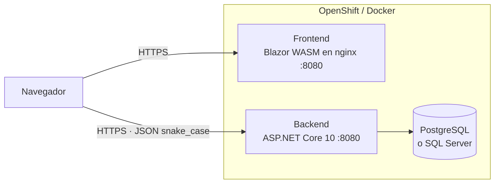
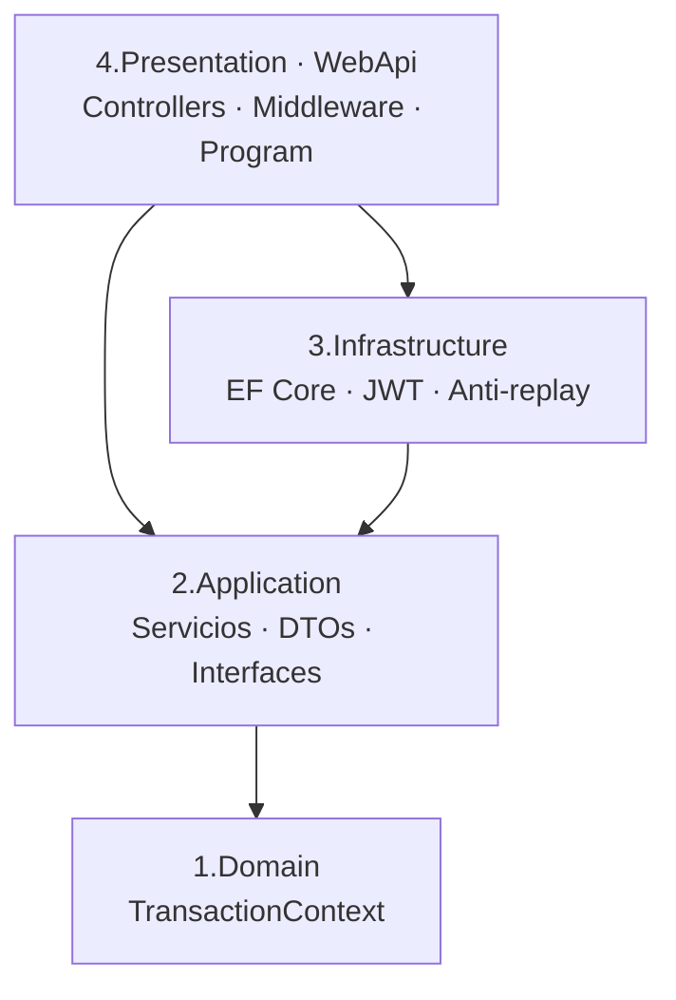
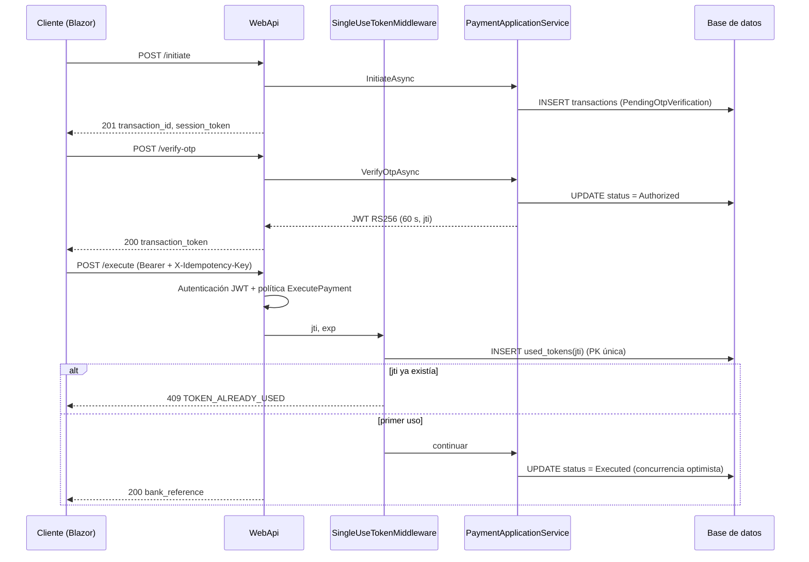

# Manual Técnico – APOC Pago Desacoplado

| | |
|---|---|
| **Producto** | APOC de pago desacoplado (.NET 10) |
| **Versión** | 1.1 – persistencia en PostgreSQL / SQL Server mediante EF Core |
| **Audiencia** | Desarrolladores, arquitectos, DevOps, DBAs |
| **Documento fuente** | *Especificacion_Arquitectura_Pago_Desacoplado_NET10.docx* |

Documentos relacionados: `docs/01…07` (guías paso a paso, Docker, OpenShift, capa de datos) y `manual-funcional.md`.

---

## 1. Introducción
Este manual describe la arquitectura, el diseño, la seguridad, la configuración y la operación de la APOC. El detalle funcional está en el manual funcional.

## 2. Arquitectura
### 2.1 Vista de contenedores

El frontend es estático (se descarga una vez); es **el navegador** quien llama directamente al backend, por eso necesita CORS y una URL pública del backend.

### 2.2 Arquitectura en capas (cebolla) del backend

Regla de dependencias: las capas internas no conocen a las externas. `Application` define las interfaces (`ITransactionRepository`, `IReplayProtectionService`, `IJwtTokenService`); `Infrastructure` las implementa; `WebApi` compone todo (inyección de dependencias).

### 2.3 Secuencia técnica del flujo


## 3. Stack tecnológico
| Componente | Tecnología |
|---|---|
| Runtime / SDK | .NET 10 (`net10.0`), C# con *nullable* e *implicit usings* |
| API | ASP.NET Core 10, controladores, OpenAPI (`Microsoft.AspNetCore.OpenApi`) |
| Autenticación | `Microsoft.AspNetCore.Authentication.JwtBearer` 10.0.x; `Microsoft.IdentityModel.JsonWebTokens` 8.14.x |
| Datos | EF Core 10 · `Npgsql.EntityFrameworkCore.PostgreSQL` 10.0.x · `Microsoft.EntityFrameworkCore.SqlServer` 10.0.x |
| Frontend | Blazor WebAssembly (standalone), Bootstrap 5.3 y Bootstrap Icons por CDN |
| Contenedores | Docker multi-stage (SDK 10.0 → ASP.NET 10.0 / nginx-unprivileged 1.27) |
| Plataforma | Docker Compose, OpenShift 4.x |

> Las versiones de paquetes se fijaron según la línea 10.x; si el restore no las encuentra, ajústelas en los `.csproj`.

## 4. Estructura de la solución
```
.
├── backend/backend.sln
│   └── src/
│       ├── 1.Domain/DecoupledPayments.Domain
│       ├── 2.Application/DecoupledPayments.Application
│       ├── 3.Infrastructure/DecoupledPayments.Infrastructure
│       └── 4.Presentation/DecoupledPayments.WebApi
├── frontend/frontend.sln
│   └── src/DecoupledPayments.Client
├── database/ (postgresql · sqlserver)
├── openshift/ · docker-compose.yml · env/
└── docs/
```
`backend.sln` y `frontend.sln` son independientes; no comparten código.

## 5. Backend
### 5.1 Componentes
| Capa | Clase / archivo | Responsabilidad |
|---|---|---|
| Domain | `TransactionContext` | Entidad y reglas: crea la transacción, `Authorize(otp)`, `MarkAsExecuted()`, `IsExpired()`. Constructor privado para el ORM |
| Application | `PaymentApplicationService` | Casos de uso `Initiate`, `VerifyOtp`, `Execute`; valida entradas |
| Application | `ITransactionRepository`, `IReplayProtectionService`, `IJwtTokenService` | Puertos hacia infraestructura |
| Application | `DTOs/PaymentDtos.cs` | Registros de petición/respuesta |
| Infrastructure | `PaymentsDbContext` + `Configurations/*` | Modelo EF Core |
| Infrastructure | `EfTransactionRepository` | Persistencia de transacciones |
| Infrastructure | `DbReplayProtectionService` | Registro atómico del `jti` |
| Infrastructure | `JwtTokenService`, `JwtKeyProvider` | Emisión RS256 y gestión de la clave |
| Infrastructure | `ExpiredTokenCleanupService` | Purga cada 5 min de `used_tokens` vencidos |
| Infrastructure | `DatabaseInitializer`, `DependencyInjection` | Inicialización con reintentos; selección del proveedor |
| WebApi | `DecoupledPaymentsController` | Endpoints |
| WebApi | `SingleUseTokenMiddleware` | Control anti-replay |
| WebApi | `ApiExceptionHandler` | Traducción de excepciones a respuestas JSON |
| WebApi | `Program.cs` | Composición, autenticación, CORS, health checks |

### 5.2 Orden del pipeline HTTP (`Program.cs`)
1. `UseExceptionHandler` → 2. `UseHttpsRedirection` → 3. `UseCors("Frontend")` → 4. `UseAuthentication` → 5. `UseAuthorization` → 6. `SingleUseTokenMiddleware` → 7. Endpoints (controladores y `/healthz*`).

El middleware se ejecuta **después** de autenticar y autorizar: el token ya tiene validados firma, emisor, audiencia, vigencia y `scope` antes de consumir el `jti`.

### 5.3 Ciclo de vida de servicios (DI)
| Servicio | Vida |
|---|---|
| `PaymentsDbContext`, `EfTransactionRepository`, `DbReplayProtectionService`, `PaymentApplicationService` | *Scoped* (por petición) |
| `JwtKeyProvider`, `JwtTokenService` | *Singleton* |
| `ExpiredTokenCleanupService` | *Hosted service* |

## 6. Contrato de la API
Base: `/api/v1/decoupled-payments` · JSON en `snake_case` · el contrato OpenAPI se expone en `/openapi/v1.json` solo en *Development*.

### 6.1 `POST /initiate` → 201
```json
// Petición
{ "merchant_id": "MERCHANT_PSE_8892", "user_document_id": "1018234567",
  "amount": 250000, "currency": "COP", "callback_url": "https://comercio.com/pago/callback" }
// Respuesta
{ "transaction_id": "3f1c…", "session_token": "st_live_…", "status": "PendingOtpVerification", "expires_in_seconds": 300 }
```
### 6.2 `POST /verify-otp` → 200
```json
{ "transaction_id": "3f1c…", "session_token": "st_live_…", "otp_code": "123456" }
// Respuesta
{ "transaction_id": "3f1c…", "status": "Authorized", "transaction_token": "eyJ…", "expires_in_seconds": 60 }
```
### 6.3 `POST /execute` → 200
Cabeceras: `Authorization: Bearer <transaction_token>` · `X-Idempotency-Key: <uuid>`
```json
{ "transaction_id": "3f1c…", "source_account_id": "ACC_SAVINGS_9812" }
// Respuesta
{ "transaction_id": "3f1c…", "bank_reference": "CUS_20261003_482915", "status": "Executed", "executed_at": "2026-10-03T15:04:05Z" }
```
### 6.4 Salud
| Ruta | Uso | Respuesta |
|---|---|---|
| `GET /healthz` | Liveness (no consulta la BD) | 200 `{"status":"ok"}` |
| `GET /healthz/ready` | Readiness (verifica la BD) | 200 `{"status":"ready"}` · 503 |

### 6.5 Errores
Formato: `{ "error": "<CÓDIGO>", "message": "<detalle>" }`.
| HTTP | Código | Origen |
|---|---|---|
| 400 | `INVALID_REQUEST` | `ArgumentException` (validación, OTP incorrecto) |
| 400 | `MISSING_IDEMPOTENCY_KEY` | Falta o es vacío `X-Idempotency-Key` |
| 401 | `MISSING_BEARER_TOKEN`, `INVALID_TOKEN`, `EXPIRED_TOKEN` o sin cuerpo | Autenticación JWT / middleware |
| 403 | `TOKEN_TRANSACTION_MISMATCH` | `transaction_id` del token ≠ el del cuerpo |
| 404 | `TRANSACTION_NOT_FOUND` | `KeyNotFoundException` |
| 409 | `TOKEN_ALREADY_USED` | Middleware anti-replay |
| 409 | `INVALID_TRANSACTION_STATE` | `InvalidOperationException` (vencida o estado inválido) |
| 409 | `CONCURRENT_UPDATE` | `DbUpdateConcurrencyException` |
| 500 | `INTERNAL_ERROR` | Error no controlado (se registra en el log) |

## 7. Seguridad
### 7.1 Transaction token (JWT)
- Algoritmo **RS256** (RSA 2048). Solo se aceptan tokens con ese algoritmo (`ValidAlgorithms`).
- Validaciones: firma, `iss`, `aud`, `exp`/`nbf` (sin tolerancia de reloj), y política `ExecutePayment` (`scope = execute_payment`).
- Claims: `sub` (documento), `jti`, `iat`, `nbf`, `exp`, `iss`, `aud`, `scope`, `transaction_id`, `amount`, `currency`.
- Vida: `Jwt:TransactionTokenTtlSeconds` (60 s).
- `MapInboundClaims = false`: los nombres de claim se conservan tal cual (`jti`, `scope`…).

### 7.2 Anti-replay
`SingleUseTokenMiddleware` toma `jti` y `exp` de las claims ya validadas y llama a `IReplayProtectionService.TryRegisterJtiAsync`. La implementación inserta el `jti` en `payments.used_tokens` (PK única). Si ya existía → `409 TOKEN_ALREADY_USED`. Es atómico entre réplicas y entre motores (ver `docs/07`).

### 7.3 Otras defensas
| Control | Detalle |
|---|---|
| Vinculación token↔transacción | El controlador compara el claim `transaction_id` con el del cuerpo (403 si difiere) |
| Concurrencia optimista | `status` como *concurrency token*; evita doble ejecución simultánea |
| CORS | Política `Frontend` con orígenes explícitos (`Cors:AllowedOrigins`) |
| Validación de entradas | Longitudes, moneda de 3 letras, monto > 0 con 2 decimales |
| Contenedores | Sin root, `allowPrivilegeEscalation: false`, `capabilities: drop ALL`, `seccompProfile: RuntimeDefault` |
| TLS | Terminado por la Route de OpenShift / proxy inverso; HTTP→HTTPS forzado |
| Secretos | Cadena de conexión y clave RSA por variables/Secrets, nunca en la imagen |

### 7.4 Análisis de amenazas (resumen)
| Amenaza | Mitigación en la APOC | Pendiente para producción |
|---|---|---|
| Repetición del débito con token capturado | Un solo uso + TTL 60 s + vinculación a la transacción | – |
| Falsificación de token | Firma RS256 + validación de emisor/audiencia | Clave en KMS/HSM + rotación (JWKS) |
| Fuerza bruta del OTP | – (sin límite) | Límite de intentos y bloqueo temporal |
| Robo de OTP almacenado | OTP simulado | No persistirlo / hash + canal externo |
| Inyección SQL | EF Core parametriza todas las consultas | – |
| Acceso no autorizado a la BD | Credenciales por secreto | Mínimo privilegio, TLS y red restringida |
| Suplantación del comercio | – | Autenticación del comercio (OAuth2/API keys) |

## 8. Capa de datos
Resumen (detalle completo en `docs/07-capa-de-datos.md`):
- Motor por configuración: `Database__Provider` = `PostgreSql` | `SqlServer`; cadena en `ConnectionStrings__Default`.
- Tablas `payments.transactions` y `payments.used_tokens`; mismos nombres y tipos equivalentes en ambos motores.
- Creación del esquema: `EnsureCreated` (por defecto, con reintentos) o scripts en `database/`.
- Fechas en UTC; estado como texto; `EnableRetryOnFailure` para fallos transitorios.

## 9. Frontend
| Elemento | Descripción |
|---|---|
| Tecnología | Blazor WebAssembly standalone; servido como archivos estáticos por nginx |
| `Pages/PaymentGateway.razor` | Asistente de 3 pasos (`/` y `/payment-gateway`) |
| `Services/PaymentApiClient.cs` | Cliente HTTP; JSON `snake_case`; envía `Authorization` e `X-Idempotency-Key` |
| `Models/PaymentModels.cs` | Modelos de petición/respuesta |
| Configuración | `wwwroot/appsettings.json` → `ApiBaseUrl`; en contenedor se regenera al arrancar desde `API_BASE_URL` (`40-appsettings.sh`) |
| nginx | `try_files … /index.html` (rutas SPA); `appsettings.json` sin caché |

## 10. Configuración
| Variable | Por defecto | Descripción |
|---|---|---|
| `Database__Provider` | `PostgreSql` | Motor |
| `ConnectionStrings__Default` | localhost PostgreSQL | Cadena de conexión |
| `Database__Initialization` | `EnsureCreated` | `EnsureCreated` · `None` |
| `Database__MaxRetries` / `Database__RetryDelaySeconds` | `10` / `3` | Reintentos de inicialización |
| `Jwt__Issuer` / `Jwt__Audience` | `decoupled-payments-auth` / `decoupled-payments-api` | Validación del token |
| `Jwt__TransactionTokenTtlSeconds` | `60` | Vida del token |
| `Jwt__KeyId` | `apoc-key-1` | `kid` |
| `Jwt__PrivateKeyPem` | vacío | Clave RSA compartida (obligatoria con >1 réplica) |
| `Cors__AllowedOrigins__N` | `https://localhost:7200`, `http://localhost:5200` | Orígenes permitidos |
| `ASPNETCORE_ENVIRONMENT` | `Production` (contenedor) | En Production no se expone OpenAPI |
| `API_BASE_URL` (frontend) | `http://localhost:5100/` | URL del backend para el navegador |

## 11. Despliegue
| Escenario | Documento | Comando clave |
|---|---|---|
| Local sin contenedores | `docs/02`, `docs/03` | `dotnet run` |
| Docker Compose | `docs/04` | `docker compose --env-file env/postgres.env --profile postgres up -d --build` |
| OpenShift | `docs/06` | `./openshift/build.sh` y `./openshift/deploy.sh` |

Puertos: backend y frontend escuchan en **8080** dentro del contenedor.

## 12. Observabilidad y operación
- **Logs:** a consola (`oc logs`, `docker compose logs`). El inicializador registra `Base de datos lista (<motor>)`; el proveedor de claves advierte si usa clave efímera.
- **Salud:** `/healthz` (liveness) y `/healthz/ready` (readiness con BD), usados por las *probes* de OpenShift.
- **Mantenimiento automático:** purga de `used_tokens` vencidos cada 5 minutos.
- **Respaldo:** a cargo del motor de base de datos.
- **Escalado:** backend con varias réplicas requiere la misma `Jwt__PrivateKeyPem` y el esquema creado de antemano.

## 13. Pruebas
**Manuales (disponibles):** recorrido por el portal; secuencia `curl` de `docs/02` sección 2.5; casos CP-01…CP-11 del manual funcional.
**Automatizadas (recomendadas, no incluidas):**
- Unitarias de `TransactionContext` y `PaymentApplicationService`.
- De integración con **Testcontainers** (PostgreSQL y SQL Server) para validar ambos proveedores, incluido el anti-replay concurrente y `CONCURRENT_UPDATE`.
- Contrato OpenAPI contra el cliente del frontend.

## 14. Decisiones de diseño
| # | Decisión | Motivo |
|---|---|---|
| D1 | Arquitectura cebolla | Aislar dominio y casos de uso del framework y de la BD |
| D2 | EF Core con proveedor por configuración | Un único binario para PostgreSQL y SQL Server |
| D3 | Anti-replay con PK única en BD | Atomicidad entre réplicas sin infraestructura adicional (Redis) |
| D4 | Middleware **después** de autenticar/autorizar | No consumir `jti` de tokens inválidos ni sin permiso |
| D5 | Concurrencia optimista sobre `status` | Evitar doble ejecución sin bloqueos pesimistas |
| D6 | Fechas UTC con conversión explícita | Resultados idénticos en ambos motores |
| D7 | `EnsureCreated` + scripts | Arranque simple en APOC y control de DBA en entornos reales |
| D8 | Clave RSA configurable | Permite varias réplicas con la misma firma |
| D9 | Frontend estático + backend por CORS | Despliegue simple e independiente de cada parte |
| D10 | Imágenes sin root en 8080 | Compatibilidad con OpenShift (SCC restricted) |

## 15. Limitaciones conocidas y hoja de ruta
**Limitaciones de la APOC**
1. OTP simulado y almacenado en claro; sin límite de intentos.
2. `session_token` se genera pero no se almacena ni valida.
3. `callback_url` y `source_account_id` se reciben pero no se usan ni persisten.
4. `X-Idempotency-Key` es obligatorio pero no se deduplica ni se guarda la respuesta.
5. La ejecución no comprueba la vigencia de la transacción (5 min), solo su estado `Authorized` y la del token (60 s).
6. El estado `Failed` existe en el modelo pero no se asigna.
7. El débito bancario es simulado.
8. Sin autenticación del comercio ni auditoría.
9. Sin migraciones EF Core ni pruebas automatizadas incluidas.
10. Con `EnsureCreated` y varias réplicas en el primer arranque puede haber carrera de creación.
11. El PostgreSQL de apoyo de OpenShift es de una sola instancia.

**Hoja de ruta sugerida:** OTP real con límite de intentos → integración bancaria → idempotencia con almacenamiento de respuestas → autenticación del comercio → clave en KMS con JWKS y rotación → migraciones EF por proveedor → pruebas con Testcontainers → métricas y trazas (OpenTelemetry) → auditoría.

## 16. Referencias internas
`docs/01-requisitos-e-instalacion.md` · `02-backend-paso-a-paso.md` · `03-frontend-paso-a-paso.md` · `04-docker-publicacion.md` · `05-solucion-de-problemas.md` · `06-openshift.md` · `07-capa-de-datos.md` · `manuales/manual-funcional.md`
